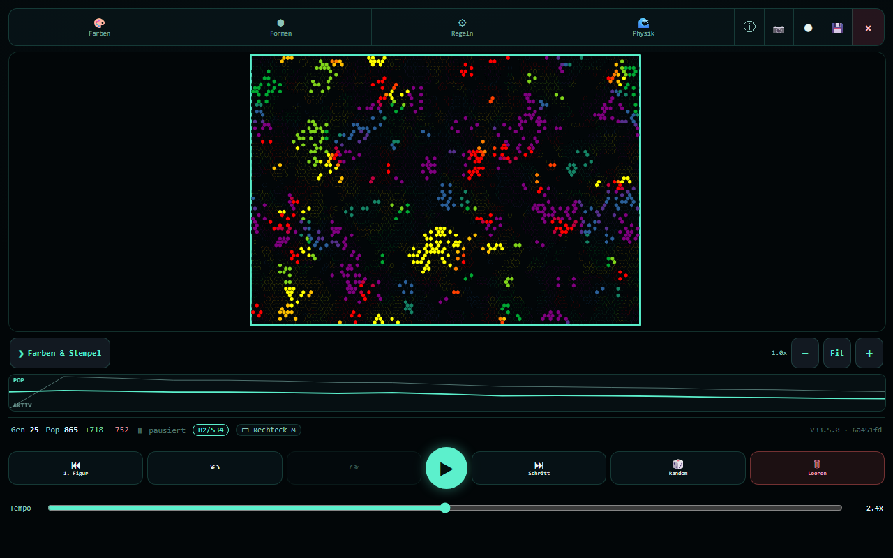
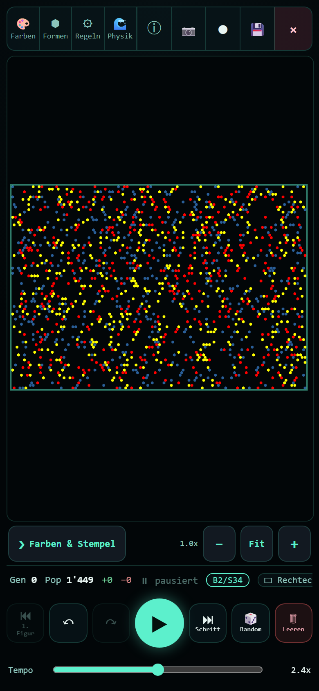

# GolHex

**Game of Life on a real hexagonal grid — plus a real-valued physics layer and a small quantum simulation.**

[](https://github.com/marcohost33-maker/HexGol/actions/workflows/unit-tests.yml)
[](https://github.com/marcohost33-maker/HexGol/actions/workflows/visual-regression.yml)
[](LICENSE)

**Live:** <https://golhex.pages.dev> — runs in the browser, installable as a PWA, no account, no tracking.

<p align="center">
  
</p>

## What it is

GolHex is a Carter-Bays **hex-topology cellular automaton** (Hexagonal Game of Life) in a single React app with a Canvas2D render path:

- **16 classic hex birth/survival rules** (`B2/S34` … `B1/S245`), plus INT and formula rules.
- **Real-valued physics modes:** snow, water, Collatz, genetics.
- **HQST:** a norm-conserving quantum tight-binding simulation (Crank-Nicolson), unit-tested in `src/lib/sim-core.js`.
- **Frames and topology:** rectangle, circle, hexagon, triangle; torus where it is well defined.
- **Mobile-first controls:** touch and trackpad gestures, undo/redo, save states, snapshot and video export, colour-blind-safe palette.
- **Grid sizes** up to 5XL (250 000 cells), with an opt-in off-main-thread worker for large grids.

<p align="center">
  
</p>

## Status

Research prototype and hobby-research app. It runs, it is unit- and e2e-tested, and it is used interactively. It is **not** a validated scientific instrument: nothing here has been peer-reviewed or externally reproduced, and performance numbers are indicative.

Non-goals: no universal physics solver, CAD/FEM or digital-twin replacement; no heavy runtime dependencies (bundle size is a tracked property).

The feature history (v29–v34, design notes, measurements) lives in [`docs/ENGINEERING_LOG.md`](docs/ENGINEERING_LOG.md); the roadmap in [`docs/ROADMAP.md`](docs/ROADMAP.md).

## Rules

Three rule families, all defined in `src/lib/sim-engine.js` (not inline in
`src/App.tsx`):

- **16 totalistic hex birth/survival rules** — `H:B2/S34` … `H:B1/S245`
  (`RULES`, `sim-engine.js:114-123`).
- **4 isotropic non-totalistic (INT) rules** — `INT H:B2o/S2` … `INT H:B2om/S2`
  (`INT_RULES`, `sim-engine.js:143-148`); at exactly 2 neighbours the *arrangement*
  (ortho / meta / para) decides.
- **One Watzlawick "communication band" rule** — `WATZ_RULE = B2,3 / S1-5`
  (`sim-engine.js:159`). It is **not** a 17th entry of the rule dropdown: it is a
  separate `watzOnly` toggle that replaces the selected rule's metadata
  (`src/App.tsx:1167`).

The Watzlawick layer maps Paul Watzlawick's pragmatic axioms of communication onto
the cell transition. Axioms A1–A4 (silence, relationship-over-content, punctuation
via cell age, analog "ghost" state) act on the transition; **A5** (symmetric vs.
complementary — count only same-coloured resp. differently-coloured neighbours) is a
separate opt-in mode (`sim-engine.js:548-549`, UI toggle `src/App.tsx:3700`).

The canonical axiom registry is
[`src/lib/watzlawick-axioms.js`](src/lib/watzlawick-axioms.js). `WATZLAWICK_AXIOMS`
exports all five and types the difference between them: A1-A4 carry
`control: { kind: "boolean" }`, A5 carries
`control: { kind: "mode", options: ["off", "sym", "komp"] }`.

The separate `AXIOMS` array in `sim-engine.js:185-190` is the **UI adapter for the
four Boolean toggles** and holds only a1-a4 on purpose. It is not a second axiom
list: the registry *derives* those four from it instead of restating their labels,
so there is one source and not two. `tests/unit/watzlawick-axioms.test.js` goes red
if the two drift apart, if the exported list is not exactly A1-A5, or if A5 is ever
remodelled as a fifth Boolean -- that last one is issue #147, closed by commit
b855a45.

Full derivation: [`docs/watzlawick-rule.md`](docs/watzlawick-rule.md).

## Getting started

```bash
npm install
npm run dev          # http://localhost:5173
npm run build        # static bundle in dist/
npm run preview      # serve dist/ on http://localhost:4173
```

## Testing

```bash
npm test             # unit tests (Vitest)
npm run test:watch   # vitest in watch mode
npm run test:e2e     # Playwright + visual baselines
```

The Playwright run starts the production preview automatically. It has two
projects: **`chromium`** (desktop, 1280×800 — functional + visual baselines) and
**`mobile`** (390×844 — the AP-4 one-page layout proof, `mobile-onepage.spec.ts`).
Run one with `npm run test:e2e -- --project=mobile`.

## Project layout

```
index.html         - Vite entry (loads /src/main.jsx)
src/
  App.tsx          - main React component (4577 lines, measured 2026-09-12)
  main.jsx         - React root mount
  worker/          - OffscreenCanvas render worker
  lib/             - 21 modules; the pure, unit-tested ones are listed below
  lib/sim-engine.js- rule tables (RULES / INT_RULES / WATZ_RULE), grid sizes, cell caps, step kernel
  lib/sim-core.js  - pure HQST core (applyH, solveCN — Crank-Nicolson); unit-tested
  lib/hex-geom.js  - pure hex cube-coord geometry (oddRToCube/cubeToOddR/hexDist/CUBE_DIRS); unit-tested
  lib/popgraph.js  - pure population-sparkline ring buffer + path scaling (push/reset/buildPaths); unit-tested
  lib/presets.js   - pure pattern-gallery: built-in seeds (verified alive), serialize/validate (fail-closed), localStorage persistence, thumbnail sampling; unit-tested
  lib/snapshot.js  - pure share/download dispatcher + filename/watermark builders (Web Share L2 + <a download>); unit-tested
  lib/recorder.js  - pure recorder state machine + codec negotiation + mockable captureStream/MediaRecorder controller (Feature 2 video); unit-tested
  (further modules: cell-style, golhex-lab-core, golhex-nine-rules-adapter,
   hex-render, hexforge-2d, nine-rules, raster-render, savestate, ui-gestures,
   worker-support, watzlawick-axioms, typography, ConwayIntro.jsx, Splash.jsx)
tests/
  unit/            - Vitest: sim-core.test.js (CN norm conservation + convergence flag),
                     hex-geom.test.js (hexagon frame == mask, centered-hex number)
  e2e/             - Playwright smoke + visual baselines (life random, XXL circle frame)
.github/
  workflows/
    unit-tests.yml         - Vitest on push/PR
    visual-regression.yml  - Playwright on push/PR
    update-snapshots.yml   - manual baseline refresh
  dependabot.yml           - weekly npm + actions update PRs
docs/
  release-notes-v17.14.md  - this version's hardening list
  watzlawick-rule.md       - WZL formula-rule: Watzlawick's 5 axioms -> cell rule
```

## URL parameters

| Parameter | Purpose                                      |
|-----------|----------------------------------------------|
| `?seed=N` | set the deterministic randomize() seed       |
| `#g=N`    | initial grid size index (0 = S … 7 = 5XL 500x500) |
| `#r=N`    | initial rule index                           |
| `#p=Name` | initial pattern (e.g. `Block`, `Pentagon`)   |
| `#w=0/1`  | wrap (`1`) or edge-clamp (`0`) topology      |
| `#m=circ` | color mix mode (`circ` or `maj`)             |
| `#d=N`    | density preset (0..4)                        |
| `#s=N`    | seed (also persisted in the URL hash)        |

## Hardware notes

- Cells render as sprite hexagons when on-screen radius >= 4 device-px,
  otherwise fall back to a stamp-mode `Uint32Array` blit.
- Sprite cache is LRU-capped at 10 entries; stamp cache at 8.
- Quiescent-row pre-scan skips inert rows during step. The scratch buffer
  is kept across calls (NR-G56) to avoid 240 GC-eligible allocations / sec
  on XXL at MAX speed.
- Dirty-bbox tracking lets the render path clip to the affected screen
  region when paint coverage is below 60%, with full-frame fallback above
  that or after viewport changes.

## License

Apache-2.0 — see [LICENSE](LICENSE) and [NOTICE](NOTICE). Versions released before 2026-10-16 (through v33.5.0) were published under MIT and remain available under it.
